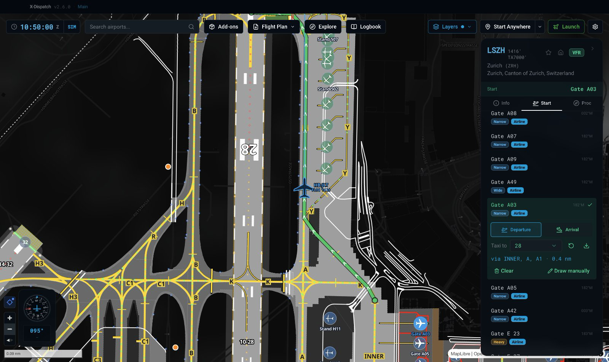
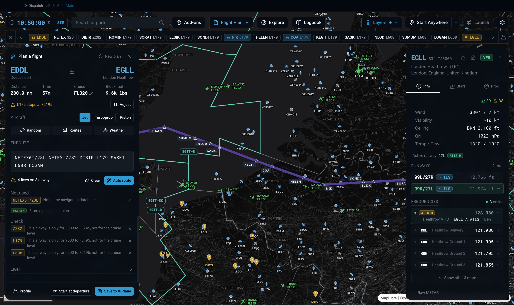
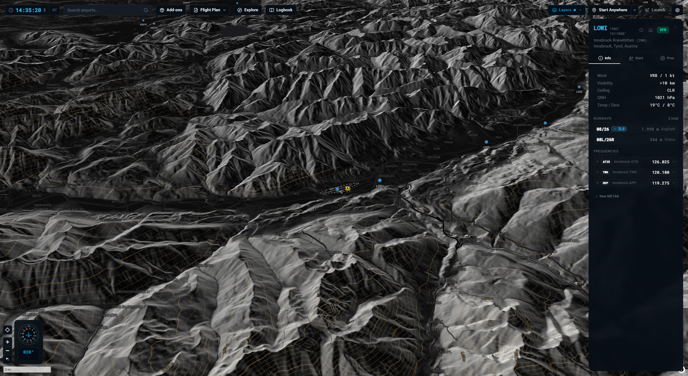
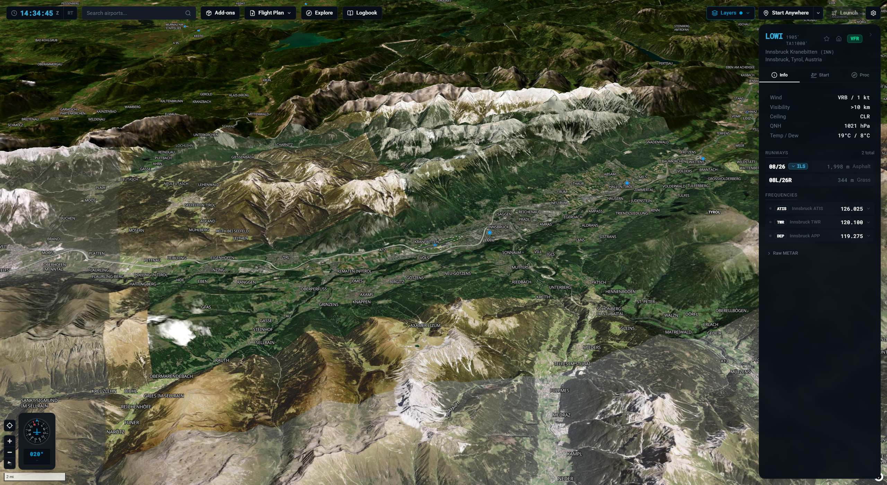
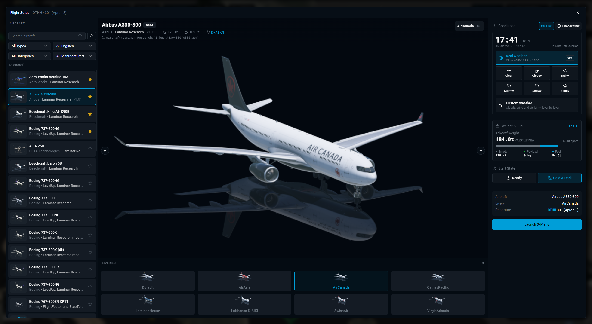
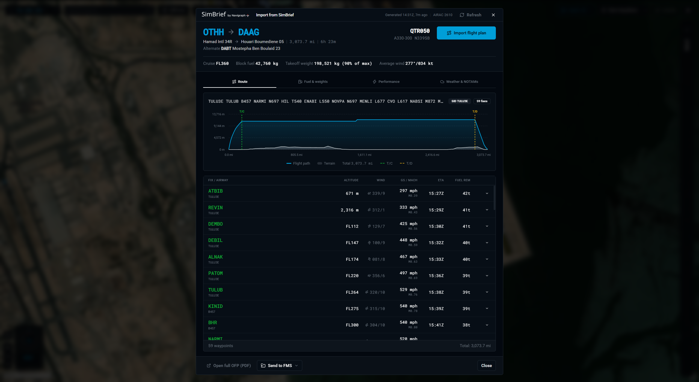
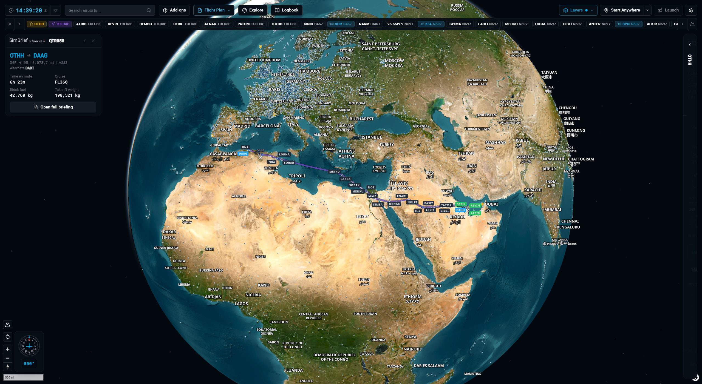
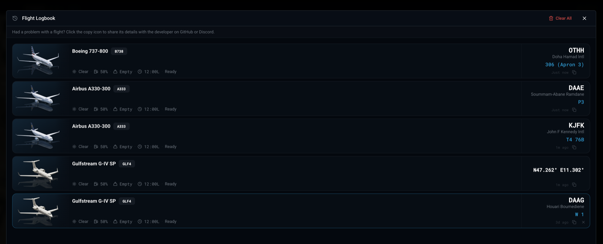
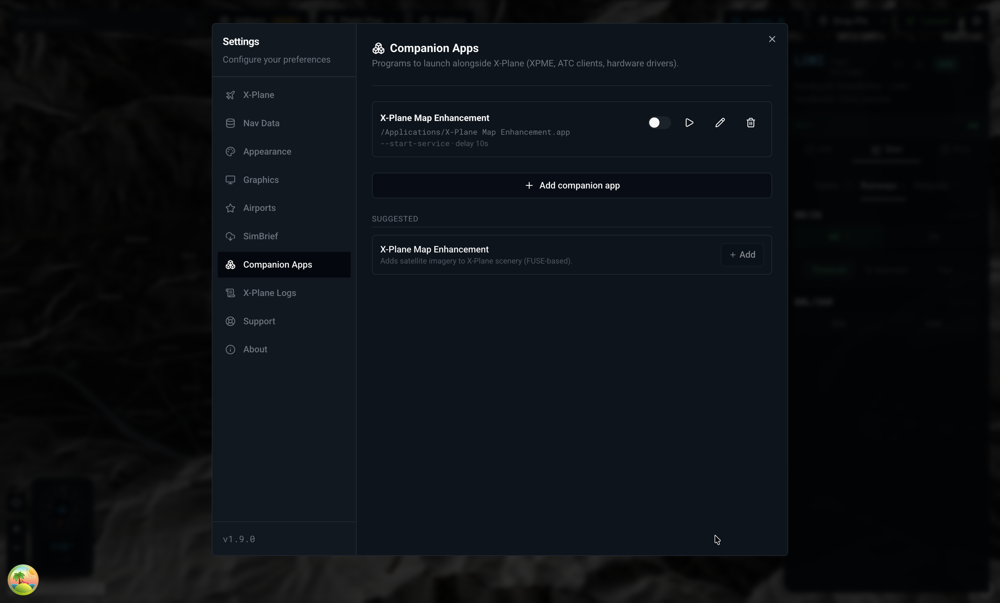
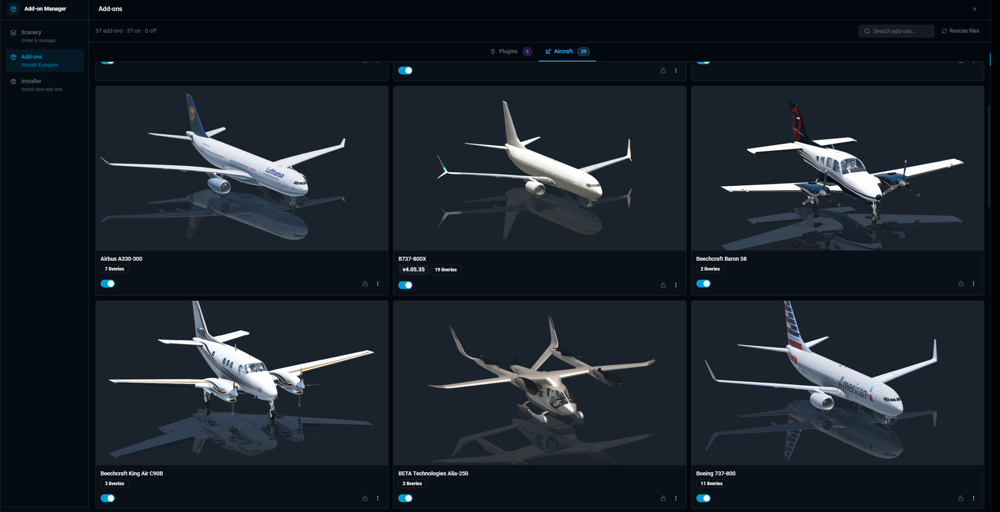

<p align="center">
  
</p>

<h1 align="center">X-Dispatch</h1>

<p align="center">
  Free flight planner, airport map and add-on manager for X-Plane 12
</p>

<p align="center">
  Requires X-Plane 12.4+ · Windows · macOS · Linux · 10 languages
</p>

<p align="center">
  <a href="https://x-dispatch.app/download/"></a>
  <a href="https://discord.gg/76UYpxXWW7"></a>
  <a href="https://ko-fi.com/lyestarzalt"></a>
</p>

<p align="center">
  <a href="https://x-dispatch.app/download/">Download</a> · <a href="https://x-dispatch.app/">Website</a> · <a href="https://x-dispatch.app/manual/">Manual</a> · <a href="https://x-dispatch.app/changelog/">Changelog</a> · <a href="https://discord.gg/76UYpxXWW7">Discord</a>
</p>

---


Every X-Plane airport on a 3D globe. Plan a route on real airways, dispatch from a real airport diagram, import SimBrief, track the flight live, log every landing and manage your add-ons. One app, no subscription.

**38,000+ downloads · 35 reviews on x-plane.org · 35,000 airports · 10 languages**

## Seen on

- [FSElite](https://fselite.net/content/x-dispatch-adds-world-map-flight-launcher-and-add-on-manager-to-x-plane-12/) — X-Dispatch adds world map, flight launcher and add-on manager to X-Plane 12
- [Q8Pilot](https://www.youtube.com/watch?v=g4NxbxpyaQ8) — video review
- [guilbair](https://www.youtube.com/watch?v=U7KC2DwMdHo) — video review
- [x-plane.org](https://forums.x-plane.org/files/file/98500-x-dispatch-world-map-flight-launcher-addon-manager-for-x-plane-12/) — download page and reviews

## What it does

### Plan the flight on real airways

Pick departure and arrival, auto-route on real airways with SIDs and STARs, even across the North Atlantic Tracks. Edit the enroute string by hand and the map redraws as you type. Save straight to X-Plane as a .fms file.


### Weather you can see on the ground

Rain, snow, fog and wind blow across the airport straight from the live METAR. At night the airfield lights come on: runway, taxiway and approach lighting, including the sequenced flashers on final.


### Your aircraft, live on the map

While X-Plane runs, a symbol follows your aircraft from the globe down to the taxiway. The Flight Strip keeps speed, altitude, heading, COM1 and QNH on screen, on the map or in its own window over X-Plane, with click-through so it never gets between you and the cockpit. Press the map button and a heading-up taxi map tells you the next turn and where to hold short.



### Fly online with VATSIM and IVAO

Live traffic, sectors and staffed airports on the map. Click a pilot to see their route, then hand their filed plan to the planner with one button.



### Search any ICAO. Jump there.

35,000 airports on a 3D globe with nav aids, airspaces and live weather underneath. Four basemaps built in (Dark, Light, Light + 3D, Satellite) plus bring-your-own style URL. Star favorites and set a home airport.


### 3D terrain

Hillshade and real elevation under the map, so mountain airports like Innsbruck read the way they should. ILS glide slopes are drawn in 3D above the runway.




### Real airport diagrams

Layouts pulled straight from your X-Plane install: runways, taxiways, gates, painted lines, lighting, custom scenery. Click any frequency in the info panel and it tunes COM1 or COM2 in the sim.


### Configure the flight at the gate

Aircraft, livery, fuel, payload, weather, time of day. Set up the whole flight before the sim opens, launch X-Plane directly or relocate mid-flight.



### SimBrief and flight plans on the globe

Fetch the latest OFP, review route, weights and fuel, drop the FMS file into your sim folder. Load any FMS file and the route draws on the globe. Export in the format your aircraft expects: X-Plane FMS, MSFS PLN and others.




### Logbook

Every flight recorded automatically with trail, landing detection, replay and landing statistics.



### Companion apps and add-ons in one place

Register companion apps (XPME, ATC clients, hardware drivers) and X-Dispatch launches them with X-Plane. Browse aircraft, plugins, liveries, Lua scripts and scenery priority across multiple X-Plane installs. Drop a file in and the installer figures out where it goes.




Full feature list and walkthroughs in the [manual](https://x-dispatch.app/manual/).

> **Don't own X-Plane?** X-Plane has a [free demo](https://www.x-plane.com/desktop/try-it/) that works with X-Dispatch, so you can try both.

## Development

```bash
npm install           # install dependencies
npm start             # dev mode with hot reload
npm run start:clean   # fresh start (clears .vite cache)
npm run start:fresh   # dev mode with --reset-cache
npm run package       # packaged app in out/ (installers: scripts/pack-velopack.sh)
npm run typecheck     # TypeScript strict mode
npm run lint          # ESLint
npm run lint:fix      # auto-fix lint issues
npm run format        # Prettier
npm run check         # typecheck + lint + format + tests + migrations
npm run test:run      # run Vitest once
```

Electron + React 18 + TypeScript, MapLibre GL JS, Zustand, SQLite. Node.js 22+.

## Support

- [Discord](https://discord.gg/76UYpxXWW7)
- [Support page](https://x-dispatch.app/support/)
- Email: hello@x-dispatch.app

## Donate

X-Dispatch started as a passion project for the X-Plane community and continues to be built with that spirit in mind: free to use and community-focused. Donations are entirely optional, but they help support continued development.

[](https://ko-fi.com/A0A21V3IZZ)

## Disclaimer

References to X-Plane, SimBrief, Navigraph, VATSIM, and IVAO are for compatibility and identification purposes only. X-Dispatch is an independent community project and is not affiliated with, endorsed by, or sponsored by their respective owners.

## License

Copyright © 2026 Lyes Tarzalt. All rights reserved. X-Dispatch is proprietary software; official builds are free to download from [x-dispatch.app](https://x-dispatch.app/download/). See [LICENSE](LICENSE).

The aircraft shapes in `public/aircraft-shapes/` are by RexKramer1 under GPL-3.0; see [their notice](public/aircraft-shapes/README.md).
